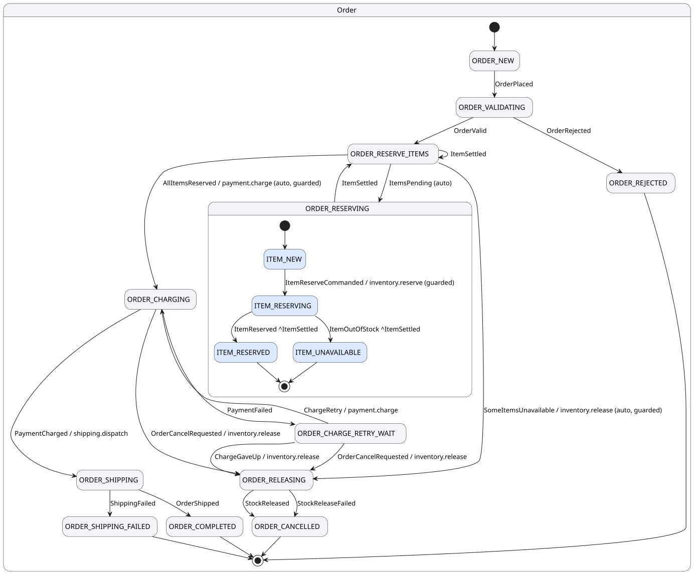

# The order example

An order and its line items, written in Java. Two levels of state, four effects, one decision
state, one bounded retry. It is the example to read first.

| | |
|---|---|
| Language | Java, read as plans: the kernel runs the plans extracted from the methods |
| Definition | [`java-src/example/OrderProfile.java`](../../java-src/example/OrderProfile.java) |
| Handlers | [`java-src/example/OrderHandlers.java`](../../java-src/example/OrderHandlers.java), annotated methods |
| Assembled by | [`src/voucha/example/order.clj`](../../src/voucha/example/order.clj), which adds the chain view, the tables, the data and the adapters |
| Its systems | [`src/voucha/example/order_adapters.clj`](../../src/voucha/example/order_adapters.clj): a warehouse, a payment provider and a carrier over the example's own tables |
| Its data | [`src/voucha/example/order_data.clj`](../../src/voucha/example/order_data.clj): a catalogue, customers, and generated orders |
| Tests | [`tests/voucha/order_example_test.clj`](../../tests/voucha/order_example_test.clj) |
| Run | `bin/voucha dev voucha.example.order/app` |

## What it does

An order is placed with its lines. Each line reserves its stock through an effect. When every
line has settled, the order decides: all reserved, charge the customer and ship; some
unavailable, release what was reserved and cancel. A failed charge waits and retries, twice,
then gives up and releases. An operator may cancel the order while it is being charged: a charge
in flight cannot be recalled, so the cancel is honoured when the charge settles, and a charge
that went through is released and recorded for a refund. That race, a charge completing after
the order had moved on, was found by the induction check; no simulated run reaches it, since
none sends an operator's cancel.

```
Order:  ORDER_NEW → ORDER_VALIDATING → ORDER_RESERVE_ITEMS ⇄ ORDER_RESERVING
                  → ORDER_CHARGING ⇄ ORDER_CHARGE_RETRY_WAIT → ORDER_SHIPPING → ORDER_COMPLETED
                  → ORDER_RELEASING → ORDER_CANCELLED
Item:   ITEM_NEW → ITEM_RESERVING → ITEM_RESERVED | ITEM_UNAVAILABLE
```

`ORDER_RESERVE_ITEMS` is the decision state: its auto transitions choose from the kernel's
counters between charging, releasing and waiting, and every settling line brings the order back
to it. The items live in `ORDER_RESERVING`, which the diagram draws as the container of the
item machine.

<p align="center"></p>

[Diagram source](../diagrams/order.puml), generated by `voucha graph --plantuml`.

## What it shows

- **A process in Java.** The definition is a `ProfileBuilder` and the handlers are methods
  annotated with `@Transition`; `voucha.sdk.java/definition` assembles the artifact the kernel
  runs. The methods are written in the plan extractor's subset, so each becomes a plan on its
  transition: the compiler checks it, the artifact pins it, and the model checker reads it
  exactly. A test runs the same orders through the plans and through the methods and compares.
- **Decision states instead of aggregation code.** No handler counts items; the rules on the
  auto transitions do, from the counters the kernel maintains.
- **Effects with outcomes.** Reserving, charging, shipping and releasing are effects declared
  with their completion and failure events; the handlers never call anything.
- **Hierarchy rules.** An item may reserve only while its order is reserving.

## Real data

The effects reach real systems, each an adapter over tables in the same database, created by
the example's own migrations (`resources/example/order/migrations`):

| System | Effect | What it does |
|---|---|---|
| warehouse | `inventory.reserve` | takes the line's quantity off `example_product.stock` and writes an `example_reservation`, keyed by the line; refuses, definitely, when the shelf is short |
| warehouse | `inventory.release` | puts back everything the order holds and marks the reservations released |
| payment provider | `payment.charge` | writes an `example_payment` per attempt, keyed by the idempotency key the platform sends; declines when the order would exceed the customer's credit limit; answers a status query from the same row |
| carrier | `shipping.dispatch` | writes an `example_shipment` with a tracking number, once per order |

The warehouse can also run as a participant through the [SQL interface](../reference/sql-interface.md)
instead of as an adapter: `voucha.example.order-participant` claims the inventory effects with
`voucha.claim_effects`, writes the same rows, and reports with `voucha.report_outcome`, in one
transaction per effect.

The catalogue has eight products, two of them scarce, and five customers, one with a credit
limit low enough to be declined. Generated orders over them exercise every path: most
complete and ship, some are cancelled for stock, some for credit, and every cancellation puts
the stock back.

## Try it

```bash
bin/voucha dev voucha.example.order/app --scenario 20
```

places twenty generated orders at start and runs them through the warehouse, the provider and
the carrier. `--seed` changes the orders. Then:

```bash
curl localhost:8710/tree/O-001                      # one order's tree
psql "${VOUCHA_DB_URL#jdbc:}" -c 'select sku, stock from example_product'       # the shelves now
psql "${VOUCHA_DB_URL#jdbc:}" -c 'select order_id, status, amount_cents from example_payment'
```

`VOUCHA_DB_URL` is the JDBC URL the banner prints; without its `jdbc:` prefix it is a PostgreSQL
URL `psql` accepts.

Or place an order by hand:

```bash
curl -XPOST localhost:8710/tree  -d '{"tree-id":"o1","root-node-id":"O1","root-node-type":"Order"}'
curl -XPOST localhost:8710/event -d '{"tree-id":"o1","node-id":"O1","event-type":"OrderPlaced",
  "payload":{"customer":"C-100","items":[{"item-id":"O1-L1","sku":"SKU-1001","qty":2,"price":1250},
                                          {"item-id":"O1-L2","sku":"SKU-1004","qty":1,"price":12900}]}}'
curl localhost:8710/tree/o1
```

Every reachable state of it, exhaustively, with TLC:

```bash
bin/voucha prove voucha.example.order/app --root Order O1 --event OrderPlaced \
    --payload '{:customer "C-9" :items [{:item-id "O1-L1" :sku "A" :qty 2 :price 10}]}' --check --liveness
```

And the proof for every order, by induction (about twelve minutes; see
[testing.md](../testing.md)): the inductive invariant is generated from the definition, the
schemas come from the Java builder, and the order's provable business invariants are among what
is proven. The induction found this example's cancel-while-charging race before any run did.

```bash
bin/voucha prove voucha.example.order/app --root Order O1 --event OrderPlaced \
    --payload '{:customer "C-9"}' --children Item=2 --inductive
```

Every interleaving of it, in memory:

```bash
bin/voucha simulate voucha.example.order/app --root Order O1 --event OrderPlaced \
    --payload '{:customer "C-9" :items [{:item-id "L1" :sku "A" :qty 2 :price 10}]}'
```
