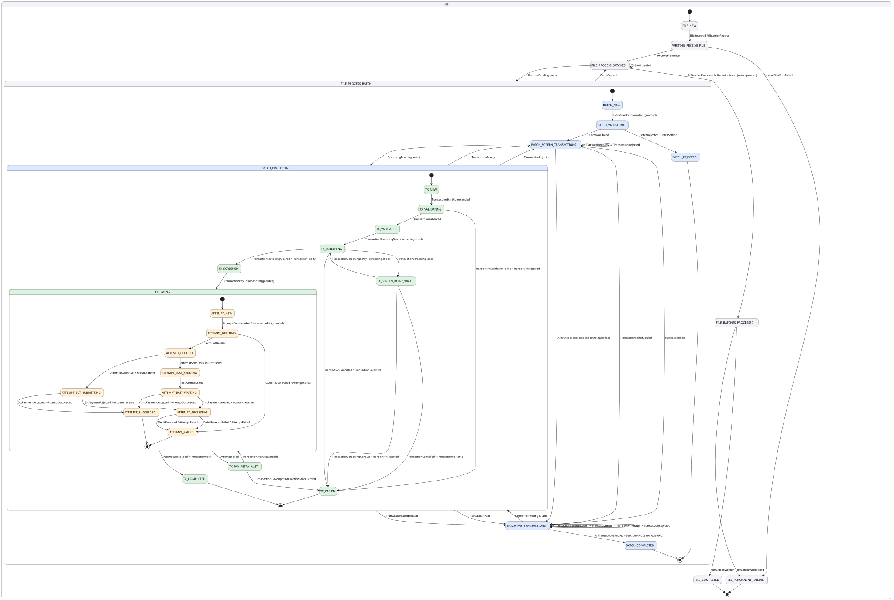

# The SEPA instant payment example

A payment file through screening and settlement, written in Clojure as plans. Four levels of
state, two rails, retries at two levels, and the fixture for most of the test suite.

| | |
|---|---|
| Language | Clojure, handlers as data |
| Definition | [`src/voucha/profiles/file_batch_transaction.clj`](../../src/voucha/profiles/file_batch_transaction.clj), transitions with their plans |
| Handlers | none in code: every handler is a `:plan` on its transition; [`src/voucha/example/batch.clj`](../../src/voucha/example/batch.clj) holds the empty registry and the app |
| Tests | most of [`tests/voucha/`](../../tests/voucha/); [`tests/voucha/example_test.clj`](../../tests/voucha/example_test.clj) is the end-to-end one |
| Run | `bin/voucha dev voucha.example.batch/app` |

## What it does

A pain.001 file arrives: batches of credit transfers. The file is archived, then each batch is
validated against its control sum and count and its transactions created. Each transaction is
validated and screened; the batch pays the survivors only once every transaction is screened
or rejected. A transaction pays through attempts, one per try: the debtor account is debited,
then the payment goes out on the SCT Inst rail asynchronously or the SCT rail synchronously; a
rejection reverses the debit and the transaction retries with a new attempt, up to a bound. When
every batch has settled, the file writes its result and completes.

```
File:        FILE_NEW → WRITING_RECEIVE_FILE → FILE_PROCESS_BATCHES ⇄ FILE_PROCESS_BATCH
                      → FILE_BATCHES_PROCESSED → FILE_COMPLETED
Batch:       BATCH_NEW → BATCH_VALIDATING → BATCH_SCREEN_TRANSACTIONS ⇄ BATCH_PROCESSING
                       ⇄ BATCH_PAY_TRANSACTIONS → BATCH_COMPLETED | BATCH_REJECTED
Transaction: TX_NEW → TX_VALIDATING → TX_VALIDATED → TX_SCREENING ⇄ TX_SCREEN_RETRY_WAIT
                    → TX_SCREENED → TX_PAYING ⇄ TX_PAY_RETRY_WAIT → TX_COMPLETED | TX_FAILED
Attempt:     ATTEMPT_NEW → ATTEMPT_DEBITING → ATTEMPT_DEBITED → ATTEMPT_INST_SENDING → ATTEMPT_INST_WAITING
                         → ATTEMPT_SCT_SUBMITTING → ATTEMPT_SUCCEEDED | ATTEMPT_REVERSING → ATTEMPT_FAILED
```

Each level hosts the next in one state: batches run in `FILE_PROCESS_BATCH`, transactions in
`BATCH_PROCESSING`, attempts in `TX_PAYING`. The decision states, `FILE_PROCESS_BATCHES`,
`BATCH_SCREEN_TRANSACTIONS` and `BATCH_PAY_TRANSACTIONS`, sit outside and decide from the
counters.

<p align="center"></p>

[Diagram source](../diagrams/sepa.puml), generated by `voucha graph --plantuml`.

## What it shows

- **Handlers as data.** Every handler is a plan on its transition: the control-sum check, the
  children created from the file's records, the bounded retries. The compiler validates them,
  the artifact pins them, and the model checker reads them exactly.
- **Two phases over one set of children.** The batch screens every transaction before any is
  paid; a transaction's settle event names its phase and takes the batch to that phase's
  decision, and a late screening event cannot make the batch pay twice.
- **Uncertain outcomes.** The instant rail answers out of band and is declared with the query
  policy: a send whose outcome is unknown is asked about, never resent.
- **Hierarchy rules.** A transaction pays only under a processing batch; an attempt runs only
  under a paying transaction; a failed transaction ignores a late pay command.
- **Terminology.** ISO 20022 and EPC vocabulary throughout.

## Try it

```bash
bin/voucha dev voucha.example.batch/app
curl -XPOST localhost:8710/tree  -d '{"tree-id":"t1","root-node-id":"F1","root-node-type":"File"}'
curl -XPOST localhost:8710/event -d '{"tree-id":"t1","node-id":"F1","event-type":"FileReceived",
  "payload":{"name":"pain.001","batches":[{"batch-id":"B1",
  "transactions":[{"tx-id":"B1-T1","amount":100,"payment-type":"SCT"}]}]}}'
curl localhost:8710/tree/t1
```

Every interleaving of a small file, in memory, and the P model of the definition:

```bash
bin/voucha simulate voucha.example.batch/app --root File F1 --event FileReceived --payload file.edn
bin/voucha model voucha.example.batch/app --root File F1 --event FileReceived --payload file.edn --check
bin/voucha prove voucha.example.batch/app --root File F1 --event FileReceived --payload file.edn --check
```

And the proof for every file, by induction (about twenty minutes; see [testing.md](../testing.md)):
the inductive invariant is generated from the definition, this example needs no lemmas of its
own, and its five business invariants are among what is proven.

```bash
bin/voucha prove voucha.example.batch/app --root File F1 --event FileReceived --payload '{:name "f"}' \
    --children Batch=2,Transaction=2 --inductive
```
